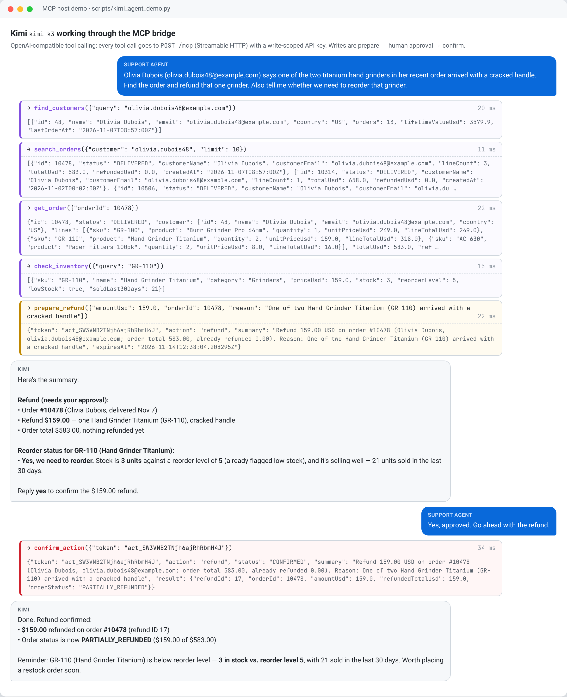
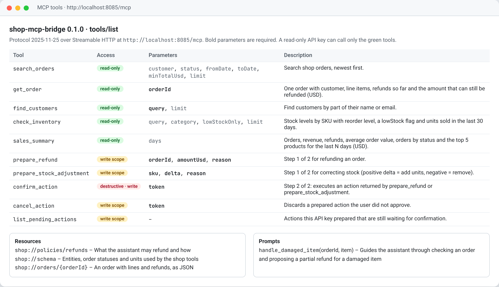
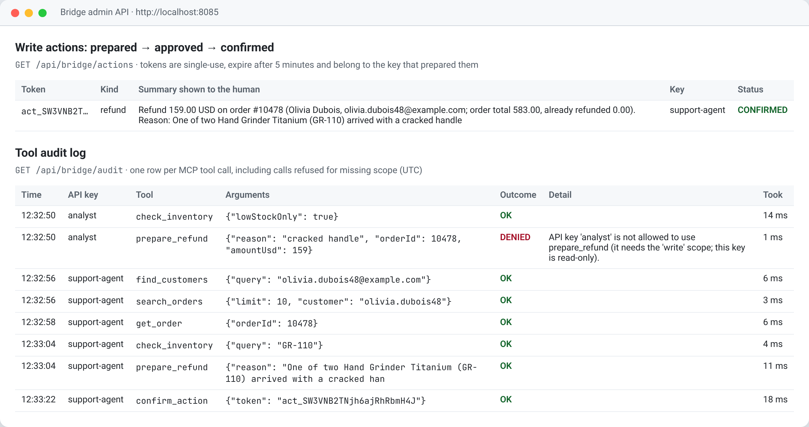
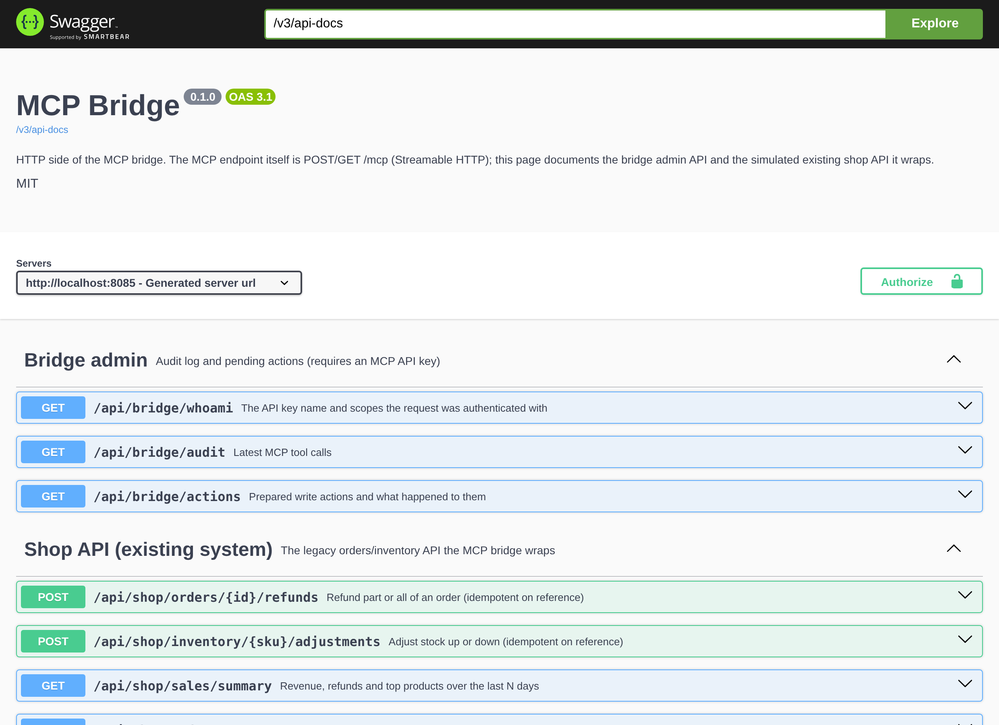
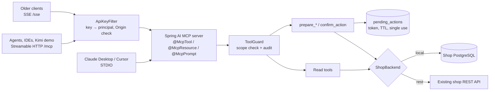

# MCP Bridge: connect Claude, Cursor and ChatGPT-style agents to an existing orders/inventory system

[](https://github.com/solace202/mcp-bridge/actions/workflows/ci.yml)


A **Model Context Protocol (MCP) server in Java** that puts an AI assistant in front of an existing shop backend
(customers, products with stock, orders, refunds). The assistant can look things up freely, but it **cannot
change anything without a human approving it first**: refunds and stock corrections go through a two-phase
*prepare → approve → confirm* flow with single-use, expiring tokens. Callers authenticate with **API keys that
carry scopes** (read-only vs. read+write), and every tool call goes to an **audit log**.

It speaks all three MCP transports: **Streamable HTTP** (`/mcp`, current spec), legacy **HTTP+SSE** (`/sse`), and
**STDIO** for desktop clients that start the server as a child process. It can read the shop's database directly
or call the shop's **existing REST API**, which is the usual case when another team owns the database.



## Features

- **10 MCP tools**
  - Read: `search_orders`, `get_order`, `find_customers`, `check_inventory`, `sales_summary`.
  - Write: `prepare_refund`, `prepare_stock_adjustment`, `confirm_action`, `cancel_action`, `list_pending_actions`.
  - Tool annotations (`readOnlyHint`, `destructiveHint`) let clients warn before calling a destructive tool.
- **3 resources and 1 prompt.** Resources: `shop://schema`, `shop://policies/refunds`, `shop://orders/{orderId}`. Prompt: `handle_damaged_item`.
- **Guarded writes.** `prepare_*` checks the business rules and returns a summary and a token. It changes nothing.
  - `confirm_action` claims the token in a single atomic `UPDATE … RETURNING`. The token works once, expires after 5 minutes and is tied to the API key that prepared it.
  - The rules are checked again at confirm time, because the order may have changed since it was prepared.
  - The token is also sent to the shop as an idempotency reference, so a retried confirm cannot refund twice.
  - Guardrails: no refund above the refundable amount or above a configurable cap (500 USD by default), no refunds on cancelled orders, stock never below zero, at most ±100 units per adjustment, and a reason is always required.
- **API-key auth with scopes.** Send `Authorization: Bearer <key>` or `X-API-Key: <key>`.
  - Only SHA-256 digests of the keys are kept in memory, and they are compared in constant time.
  - Read-only keys are refused write tools inside the MCP session; the client gets a readable tool error, not a dropped connection.
  - Browser requests from foreign `Origin`s are rejected, which protects a locally running server from DNS rebinding.
- **Audit log.** Every call is recorded with the key, tool, arguments, outcome (`OK` / `DENIED` / `REJECTED` / `ERROR`) and duration. Unexpected errors reach the model only as an error id, never as SQL or a stack trace.
- **Two backends**, selected with `BRIDGE_BACKEND`:
  - `local` uses JDBC against the shop database.
  - `rest` calls the shop's HTTP API. Upstream 404/422 responses are translated into the same readable tool errors.
- **LLM client demo.** [`scripts/kimi_agent_demo.py`](scripts/kimi_agent_demo.py) is a ~110-line MCP host. It turns the MCP tool list into OpenAI-style function tools and lets Kimi (`kimi-k3`) work a real support case end to end. The transcript is in [`docs/demo/transcript.md`](docs/demo/transcript.md).

## Screenshots

| **Tool list** as an MCP client sees it: access level, parameters, resources, prompt<br/> | **Approval log and audit trail**: the confirmed refund, and a read-only key refused a write tool<br/> |
|---|---|
| **The conversation** (also the cover image above): find the customer, then the order, prepare a refund, ask, confirm<br/> | **Swagger**: bridge admin API, plus the simulated existing shop API<br/> |

## How it works



The filter authenticates the HTTP request and stores the principal on it. A custom
`McpTransportContextExtractor` then copies the principal into the MCP transport context, so each tool call knows
which key made it. Spring AI's auto-configured transports are replaced with identical ones that add this extractor.

## Quick start

```bash
cp .env.example .env               # set MCP_ADMIN_KEY / MCP_READONLY_KEY / SHOP_API_TOKEN (16+ chars)
docker compose up -d --build       # PostgreSQL + bridge on http://localhost:8080, demo shop data included
curl -s localhost:8080/api/bridge/whoami -H "X-API-Key: $MCP_ADMIN_KEY"
```

Run the LLM demo (needs `pip install mcp openai` and a Moonshot key; any OpenAI-compatible model works through `LLM_BASE_URL` / `LLM_MODEL`):

```bash
export MOONSHOT_API_KEY=...        # never commit it
python scripts/kimi_agent_demo.py --url http://localhost:8080/mcp --key "$MCP_ADMIN_KEY"
python scripts/capture_screenshots.py --base-url http://localhost:8080 --key "$MCP_ADMIN_KEY"
```

To try it with **MCP Inspector**, run `npx @modelcontextprotocol/inspector` and connect to
`http://localhost:8080/mcp` (Streamable HTTP) with the header `Authorization: Bearer <key>`.

## Connect a client

**Claude Desktop** (`claude_desktop_config.json`). Claude Desktop starts the jar over STDIO; build it first with `mvn -DskipTests package`:

```json
{
  "mcpServers": {
    "shop": {
      "command": "java",
      "args": ["-jar", "/path/to/mcp-bridge/target/mcp-bridge-0.1.0.jar", "--spring.profiles.active=stdio"],
      "env": {
        "DB_URL": "jdbc:postgresql://localhost:5432/shop",
        "DB_USER": "shop",
        "DB_PASSWORD": "shop"
      }
    }
  }
}
```

Use `"BRIDGE_BACKEND": "rest"` with `SHOP_API_URL` / `SHOP_API_TOKEN` instead of the DB settings to go through the
shop API. The STDIO user gets the scopes in `bridge.stdio.scopes` (read+write by default; writes still need confirmation).

**Cursor** (`~/.cursor/mcp.json` or `.cursor/mcp.json`) connects to the running server over HTTP with a key:

```json
{
  "mcpServers": {
    "shop": {
      "url": "http://localhost:8080/mcp",
      "headers": { "Authorization": "Bearer ${env:SHOP_MCP_KEY}" }
    }
  }
}
```

Other HTTP clients (VS Code, Claude Code, custom agents) use the same URL and header. For clients that only speak
the 2024 HTTP+SSE transport, start the server with `MCP_PROTOCOL=SSE` and point them to `http://localhost:8080/sse`.

## Configuration

| Variable | Default | Meaning |
|---|---|---|
| `MCP_ADMIN_KEY` / `MCP_ADMIN_KEY_NAME` | dev value / `support-agent` | Key with `read` + `write` scopes |
| `MCP_READONLY_KEY` / `MCP_READONLY_KEY_NAME` | dev value / `analyst` | Key with `read` only |
| `MCP_PROTOCOL` | `STREAMABLE` | `STREAMABLE` (`/mcp`) or `SSE` (`/sse` + `/mcp/message`) |
| `MCP_ALLOWED_ORIGINS` | – | Extra browser origins allowed besides localhost |
| `BRIDGE_BACKEND` | `local` | `local` = shop DB, `rest` = shop HTTP API |
| `SHOP_API_URL` / `SHOP_API_TOKEN` | self / dev value | Shop API base URL and its `X-Shop-Token` |
| `MAX_REFUND_USD` | `500.00` | Largest refund the assistant may prepare |
| `DB_URL` / `DB_USER` / `DB_PASSWORD` | local PostgreSQL | Shop database |

More keys can be added in `application.yml` under `bridge.security.keys` (name, key, scopes).

## Tests

`mvn verify` runs **34 tests**: unit tests, and integration tests against PostgreSQL in Testcontainers. The ITs use
the **official MCP Java SDK client**, the same code path a real client takes.

| Suite | What it proves |
|---|---|
| `McpReadToolsIT` (8) | Tool list, schemas and hints; every filter; readable errors; resources, template and prompt; audit rows |
| `WriteActionsIT` (8) | Prepare changes nothing, confirm refunds; one success out of 4 concurrent confirms; expiry; per-key tokens; cancel; guardrails; re-check at confirm; stock flow |
| `McpSecurityIT` (8) | 401 without or with a wrong key, Bearer and X-API-Key, Origin check, read-only key denied and audited, admin and shop API auth |
| `RestBackendIT` (2) | Same tools through the shop HTTP API, including upstream 422 → tool error |
| `SseTransportIT` (2) | Legacy SSE transport with the same keys and scopes |
| `StdioTransportIT` (1) | Spawns the server as a child process with the `stdio` profile and talks MCP over stdin/stdout |
| `ApiKeyRegistryTest` (3), `MoneyTest` (2) | Key hashing and validation, money conversion |

CI (GitHub Actions) runs the suite, publishes a test summary and builds the Docker image.

## Project layout

```
src/main/java/dev/mcpbridge/
  mcp/        @McpTool read/write tools, resources + prompt, ToolGuard (scopes, audit), PendingActionService
  security/   ApiKeyFilter, ApiKeyRegistry, transport context extractor, shop API token filter
  backend/    JdbcShopBackend (local), RestShopBackend (rest)
  shop/       ShopBackend port, models, Money, errors
  web/        Simulated existing shop REST API, bridge admin API
src/main/resources/db/migration/   schema + deterministic demo data (60 customers, 30 products, 600 orders)
scripts/      kimi_agent_demo.py (MCP host + LLM), capture_screenshots.py, test_report.py
```

## License

MIT, see [LICENSE](LICENSE).
